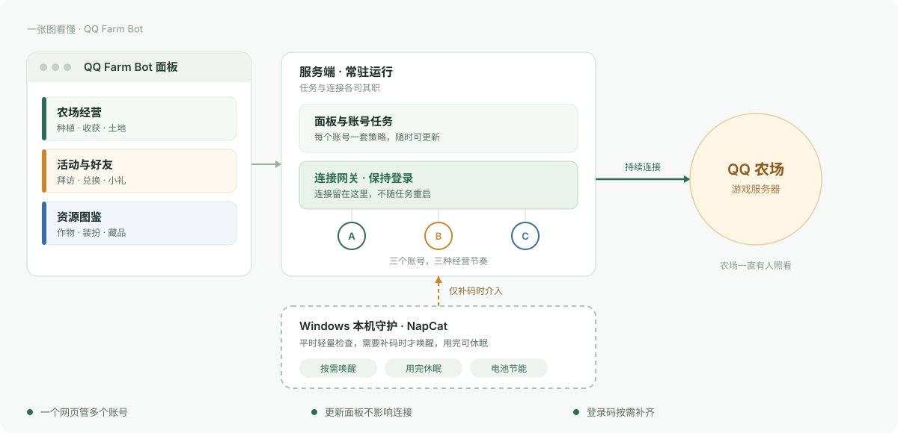
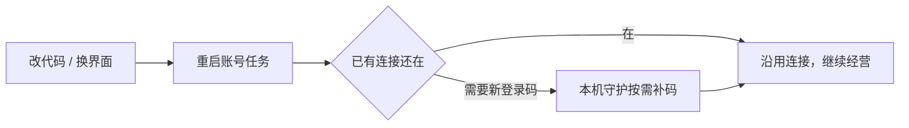

<div align="center">

# QQ Farm Bot

**一个自己托管的 QQ 农场多账号自动化面板。**

在一个网页里同时照看几个农场号 —— 种植、收获、好友、活动和图鉴各自安排；
连接由常驻服务保持，登录码需要更新时，再由本机守护按需补齐。


[它是什么](#它是什么) · [能做什么](#能做什么) · [不一样的地方](#不一样的地方) · [农场百科](#农场百科) · [快速开始](#快速开始) · [文档](#文档) · [致谢](#致谢)

</div>

---

<div align="center">
  
  <br>
  <sub>示意图 · 一个网页面板连到常驻服务，服务保持与游戏的连接；本机守护只在需要补码时出现。</sub>
</div>

---

## 它是什么

QQ Farm Bot 是**跑在你自己机器上的网页面板**，用来替你照看 QQ 农场里的多个账号。登录后，每个账号都可以分别安排种植、施肥、收获、土地升级、好友互动和活动兑换；你也可以随时从面板里接手某块地、某次收获。

它不是一个跑完就退出的脚本：面板、账号任务和连接分开运行，日常经营按账号持续进行，界面更新与策略调整都不必打断正在跑的农场。配置和运行状态留在本地，不经过第三方服务。

| 一眼看清 | |
| --- | --- |
| **给谁用** | 同时经营几个农场号、不想一直开着游戏界面的人 |
| **跑在哪** | 自己的 Windows / Linux 机器或服务器，浏览器打开面板即可 |
| **怎么分工** | 网页负责看和操作，服务端负责经营与保持连接，本机守护负责补码 |
| **收录了多少** | 1000+ 物品图标、30 件藏品图标，以及作物、装扮、变异与活动奖励 |

## 能做什么

| | 模块 | 具体能做的事 |
| :---: | --- | --- |
| 🌱 | **农场经营** | 种植、施肥、收获、土地升级、统一收获与延迟收获 |
| 👥 | **多账号** | 每个账号一套策略与运行状态，切换时保留各自的浏览位置和筛选条件 |
| 🤝 | **好友互动** | 好友列表、土地查看、帮忙与互动任务 |
| 🎁 | **活动中心** | 奶茶经营与兑换、节令小礼、活动进度与奖励 |
| 🖼️ | **收藏图鉴** | 作物、装扮、头像框、铭牌、藏品和变异宝典，支持搜索与筛选 |
| 📊 | **运行管理** | 日志、统计、通知、连接状态与补码记录 |

手动操作不必等自动任务走完一整轮：已经发出的操作先结束，接下来的自动步骤把位置让给你。

## 不一样的地方

农场自动化本身并不新鲜，这个项目把力气花在**让它长期好用**上。

### 1 · 连接留着，界面随便换

连接和经营任务分开运行。改完策略、更新面板或重启某个账号时，已有连接继续用，不必重新登录；面板是静态资源，换一套界面也不会打断正在经营的账号。



### 2 · 本机守护，需要时才醒

登录码过期时，一个轻量守护会通过 NapCat 取回新码并交回面板，把原来要来回操作的流程串成一条链路。平时只做轻量检查，用完可以让宿主休眠；笔记本用电池时还能切到节能模式。**农场继续跑，电脑不必一直保持完整客户端常驻。** 微信账号使用面板扫码，不经过这套 QQ 守护。

### 3 · 活动换皮，自己跟上

活动每期都在换名字、换 ID、换图标，底层玩法却是同一套。项目按"族"整理活动，新一期认出属于哪一族，大部分逻辑直接复用；判断是否在期只看服务端真实下发的标记，不靠字段默认值猜。

### 4 · 图鉴能看，不只是编号

作物、装扮、藏品、变异效果和活动奖励都有对应图片。变异宝典可以搜、可以筛、可以按系列浏览，土地详情直接看到生长状态与可执行操作。资源工具按游戏清单定位原图，把散落的素材整理成一份可复用的资源库。

## 农场百科

<div align="center">
  
  <br>
  <sub>仓库里收录的装扮、道具与建筑图标（节选）</sub>
</div>

<br>

<div align="center">
  
  
  
  
  
  
  
  
  <br>
  <sub>30 件藏品与 10 个展台图标（节选）</sub>
</div>

<br>

<div align="center">
  
  
  
  
  
  
  <br>
  <sub>作物种子图标（节选）</sub>
</div>

这些不是游戏截图。图片按游戏资源清单里的资源名与标识，从官方 CDN 或已保存缓存还原；另一部分来自核对过身份与文件哈希的固定版本公开快照，项目已有素材则单独标为同步来源。逐图出处见 [资源来源索引](core/src/gameConfig/art-resource-sources.json)，采集与审计工具在 `tools/asset-fetcher/`。

客户端有时会提前带上动物、牧草等资源。**收录图片只是补全资源库，不代表对应玩法已经开放。**

## 快速开始

| 环境 | 要求 |
| --- | --- |
| 面板 | Node.js 20+、pnpm 10；Windows 或 Linux |
| 前端构建 | `pnpm build:web` |
| QQ 自动补码守护（可选） | Windows、Python 3.10+ 与已配置的 NapCat |

```bash
git clone https://github.com/DX3906-0/qq-farm-bot.git
cd qq-farm-bot
pnpm install
pnpm build:web
ADMIN_PORT=3007 pnpm dev:core
```

Windows PowerShell：

```powershell
$env:ADMIN_PORT = "3007"
pnpm dev:core
```

打开 `http://localhost:3007`，登录后添加账号、设置经营策略。**首次使用请先修改默认管理员密码。**

守护是可选组件，只有需要自动补码时才配置：

```powershell
Copy-Item tools/capture-guard/.napcat-guard-config.json.example tools/capture-guard/.napcat-guard-config.json
python tools/capture-guard/napcat-code-guard.py --once   # 先跑一轮确认配置
python tools/capture-guard/napcat-code-guard.py          # 常驻
```

常用入口：`守护-立即启动.bat` 后台启动、`守护-安装自启.bat` 设置开机启动、`napcat_guard.log` 查看最近结果。使用 Docker 时，先完成前端构建，再运行 `docker compose up -d --build`。

## 项目结构

```text
core/                   农场业务、连接网关、协议与配置
  docs/                 活动适配、协议运行时等专题文档
web/                    Vue 3 面板与静态资源
tools/
  capture-guard/        本机补码守护
  asset-fetcher/        资源采集与审计
docs/                   架构说明与图例
```

## 文档

- 📐 [架构设计](docs/architecture.md) —— 关键设计决策与取舍
- 🎪 [活动适配](core/docs/activity-update-runbook.md) —— 新活动怎么接
- 📅 [活动自动计划](core/docs/activity-auto-plan.md) —— 任务编排说明
- 🧩 [协议运行时](core/docs/tsdk-ace-runtime.md) —— 安全运行时接入
- 🔄 [客户端更新](core/docs/tsdk-update-runbook.md) —— 版本升级的应对
- 🖼️ [资源来源索引](core/src/gameConfig/art-resource-sources.json) —— 逐张图的出处

## 参与

欢迎提交问题、改进界面或补充活动适配。反馈时附上复现步骤和已去除账号、登录码的日志即可。

```bash
pnpm build:web
pnpm -C core test
```

地址、口令与账号映射保存在本地配置或环境变量中，不提交到仓库。补充图片请保留原图和来源信息。

## 致谢

本项目的架构基线与核心业务逻辑来自 [muyuewang/qq-farm-bot-404](https://github.com/muyuewang/qq-farm-bot-404)，活动与协议适配参考了 [liyangpengs/qq-farm-bot](https://github.com/liyangpengs/qq-farm-bot)。资源补充参考 [Xb-Fishing/qq-farm-evolution](https://github.com/Xb-Fishing/qq-farm-evolution) 与 [chengleier/qq-farm-bot](https://github.com/chengleier/qq-farm-bot)，逐文件出处保留在来源索引中。

连接与任务分离、本机按需补码守护、活动族复用和资源整理，是本项目在这些基础上的持续扩展。

本项目自行编写的代码适用 [MIT License](LICENSE)；继承代码与游戏美术资源按各自权利归属处理。仅供学习研究，请遵守游戏用户协议。
