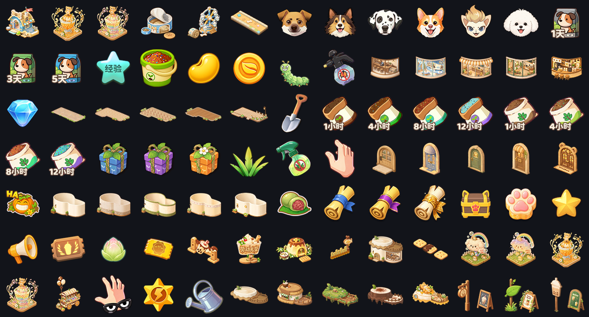

<div align="center">

# QQ 农场 · 多账号自动化

**一台机器，管一队农场号。**

改代码不掉线 · 网络抖一抖不用爬起来扫码 · 活动换皮自己跟上

</div>

<div align="center">


**163** 装扮图标 · **26** 份协议定义 · **8** 个活动族 · **46** 个测试文件

</div>

---

<div align="center">
  
  <br>
  <sub>仓库里收录的 163 个装扮图标 —— 全部从官方 CDN 直取，不用点开游戏界面</sub>
</div>

---

## 先说清楚这东西是从哪来的

**本项目的整体架构、核心业务逻辑，基线来自 [404](https://github.com/muyuewang/qq-farm-bot-404) 的开源项目。**

它解决的是「怎么把农场协议跑起来」这个问题。没有它，后面的一切无从谈起。

在此之上，还有另一个上游 [liyangpengs/qq-farm-bot](https://github.com/liyangpengs/qq-farm-bot)
贡献了活动适配与新协议跟进，代码里若干模块直接标注了「移植自」出处
（微信凭证保活、请求优先级闸门、萌宠日记等），保持原样保留。

**这个仓库相对它的增量是**：把「连接」和「业务」拆成两个进程，
让改代码不再需要重新抓码；以及配套的掉线与凭证自愈体系。
详见下面三节。

<div align="center">

| 来源 | 提供了什么 |
|:---|:---|
| [**404**](https://github.com/muyuewang/qq-farm-bot-404) | 架构基线、核心业务逻辑、协议接入 |
| [**liyangpengs**](https://github.com/liyangpengs/qq-farm-bot) | 活动适配、新协议跟进、若干移植模块 |
| **本仓库** | 网关/worker 分离、掉线自愈、资源反解工具链 |

</div>

> 两个上游均**未声明开源许可证**。本仓库的 MIT 协议仅覆盖本项目自行编写的部分，
> 继承部分的权利归原作者，请尊重上游的授权状态。

---

**↓ 下面是本项目做的增量部分**

---

## 为什么会有人为它加这层

农场类小游戏有个共同的设计：**登录凭证是一次性的**。

凭证过期了，不是"重新登录"那么简单 —— 服务器会把你的重连请求当成可疑行为，
直接拒掉。拒得越多，风控越重。到最后只剩一条路：**人工重新抓包**。

于是所有做这类自动化的项目都会撞上同一堵墙：

> 改一行代码 → 重启进程 → 凭证失效 → 手动抓包 → 明天再改一行

一天改十次，抓十次包。这种项目活不长。

这个仓库就是为了拆掉这堵墙。做法不是"想办法绕过风控"，
而是**让进程重启和凭证彻底解绑**。

---

## 三件事，上游没那么做

### 一 · 改代码不用重新抓码

连接和业务被拆成两个进程。

`gateway` 攥着游戏连接不放，`worker` 随时可以杀掉重启。
你改完一行逻辑，重启 worker，连接那头根本不知道发生了什么：

```
─────────────────────────────────────────────
  你：改代码 → 重启 worker
  系统：连接还在，凭证没动，农场继续跑
─────────────────────────────────────────────
```

这条链路走通之后，开发体验完全不一样了 ——
从"每次改动都是一次冒险"，变成"随便改，反正不掉"。

> 前提是游戏连接本身仍然健康。网关进程重启就得重新抓码，这是凭证机制决定的，绕不过去。

### 二 · 网络抖一下，不用你爬起来扫码

游戏服务器会偶发静默 —— 连接看着是好的，请求发出去石沉大海。

遇到这种情况，多数方案的结局是"判定卡死 → 重连 → 撞风控 → 等人工"。
这里的做法分两级：

**先让路。** 连续几次请求没回音，立刻停掉所有业务请求，只留心跳。
把带宽全让给心跳，等连接自己缓过来。恢复后自动继续，不用你管。

**再判死。** 让路也不管用，才认定连接真坏了。这个阈值不是拍脑袋定的，
是拿几天的真实数据反推出来的 —— 结论让人意外：**大部分"假死"其实是患者在装死**，
连接本身没坏。所以判定必须慢一点，宁可多等一分钟，也别白白浪费一个凭证。

### 三 · 活动换皮，系统自己跟上

游戏活动每期都在换名字、换 ID、换图标，但底层玩法是同一套。

这里把活动按"族"来管：一个新活动上线，只要能认出它属于哪个族，
大部分逻辑直接复用。判断"活动是否在期"也有讲究 —— 不能看字段有没有值，
因为服务端会给不存在的活动也返回默认值。得看特定标记，每个族一个判据。

---

## 顺手做的一件小事

想给装扮图鉴配图，但游戏里的资源不在本地 —— 只有你把对应界面点开过，
资源才会被缓存下来。没点开，就"没图"。

其实"本地没图"不等于"游戏里没有"。资源的真实地址藏在资源清单里，
只要能还原出清单里的 ID 编码规则，就能直接从官方 CDN 取图，**完全不用打开游戏**。

于是就有了仓库里那 163 个图标。

这套工具在 `tools/asset-fetcher/`，换个匹配规则就能抓别的资源类型。
比"拿到图"更容易翻车的是**图放上去了但界面还是裂的** ——
漏登记映射表、漏登记名称表、两个目录只同步了一个。
所以还附了两个审计脚本，`--check` 可以直接进 CI。

---

## 它长什么样

| | |
|---|---|
| **后端** | Node.js · Express · protobufjs |
| **前端** | Vue 3 · TypeScript · Pinia · Vite |
| **部署** | Docker Compose |
| **采集守护** | Python · NapCat · Win32 API |

```
core/          后端 —— 网关/worker 运行时、业务逻辑、协议定义
web/           前端 —— Vue 3 面板
tools/
  capture-guard/    守护 —— 掉线检测、自动补码、宿主管控
  asset-fetcher/    资源 —— 从官方 CDN 批量取美术资源
docs/          设计与踩坑记录
```

---

## 跑起来

所有环境相关的地址和口令都走环境变量，仓库里不含任何真实凭据。

```bash
# 面板
export FARM_PANEL="http://YOUR_HOST:3007"
export FARM_PANEL_USER="admin"
export FARM_PANEL_PASS="your-password"

# 账号映射（面板账号 id → QQ 号）
export FARM_ACCOUNT_1_UIN="1000000001"
export FARM_ACCOUNT_10_UIN="1000000002"
```

```bash
cd core && npm install && npm start      # 后端
cd web  && npm install && npm run dev    # 前端
```

守护进程（Windows 本机，负责掉线后自动补码）：

```bash
cd tools/capture-guard
cp .napcat-guard-config.json.example .napcat-guard-config.json
python napcat-code-guard.py --once    # 先跑一轮，确认配置对
python napcat-code-guard.py           # 常驻
```

<details>
<summary><b>守护使用注意事项</b></summary>

`--stop` 会杀掉**全局**守护进程（包括开机自启那个），而且它不会自动恢复。
日常只想清熔断状态请用 `--reset`，它只动熔断文件，不碰进程。

</details>

---

## 想看得更深

README 只讲做了什么。至于**为什么这么做**，
包括那些走了弯路才想明白的地方，都在这里：

- [**架构设计**](docs/architecture.md) —— 关键决策的取舍依据、失败方案复盘
- [**活动适配**](core/docs/activity-update-runbook.md) —— 活动换皮的适配流程
- [**协议运行时**](core/docs/tsdk-ace-runtime.md) —— 安全运行时接入
- [**客户端更新**](core/docs/tsdk-update-runbook.md) —— 版本升级的应对

---

## 测试

```bash
cd core && node --test test/*.test.js
```

46 个测试文件。有 2 个已知失败（对外地址广播顺序、商店轮询时序），
跟核心逻辑无关，一直没修。

---

## 声明

本项目仅供**个人学习与技术研究** —— 分布式进程架构、协议交互分析、
Cocos 资源打包格式，这些才是它的主题。

使用风险自负，包括但不限于账号安全与游戏用户协议合规性。
请勿用于商业用途或大规模批量操作。

**关于代码来源**：架构基线与核心业务逻辑继承自
[404](https://github.com/muyuewang/qq-farm-bot-404)，
部分模块移植自 [liyangpengs](https://github.com/liyangpengs/qq-farm-bot)（源码内已标注）。
两个上游均未声明开源许可证，本仓库的 MIT 仅覆盖自行编写的部分，
详见 [LICENSE](LICENSE) 的「授权范围说明」。
若你是上游作者并认为使用方式不妥，请提 issue，会立即处理。

`core/src/gameConfig/deco_icons/` 中的图片版权归腾讯及相关权利人所有，
仅作为资源获取工具链的验证样本收录，不在 MIT 授权范围内。

<div align="center">
<sub>如果这套拆分思路对你有用，给个 ⭐ 就好</sub>
</div>