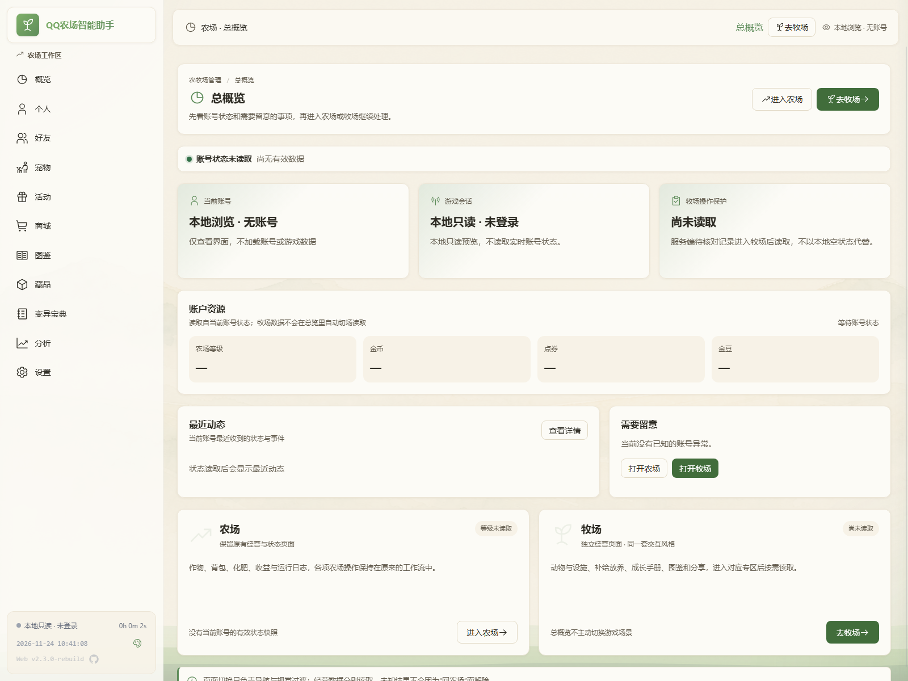

<div align="center">

# QQ Farm Bot

**自托管的 QQ 农场与牧场多账号管理面板**

在一个网页里管理多个账号：查看运行状态、安排日常经营、管理好友、活动和图鉴；农场与牧场各有独立页面和自动化设置。


[功能一览](#功能一览) · [页面截图](#页面截图) · [设计特点](#设计特点) · [快速开始](#快速开始) · [项目结构](#项目结构) · [安全与隐私](#安全与隐私)

</div>

---

## 项目简介

QQ Farm Bot 是运行在自有电脑或服务器上的 Web 控制面板及自动化服务。它面向同时管理多个游戏账号的用户，提供农场、牧场、好友、活动、图鉴和运行状态等功能。

项目将网页界面、业务 worker 与连接网关分开管理。界面用于查看状态和发起操作；后台服务负责按账号执行任务。登录凭据、账号配置和运行数据保存在部署环境中，不应提交到代码仓库。

## 功能一览

| 模块 | 可以做什么 |
| --- | --- |
| 多账号 | 分账号查看连接状态、运行记录与自动化配置；账号切换时隔离各自的数据状态 |
| 农场 | 管理种植、施肥、收获、土地与好友互动；查看活动、商城、图鉴和运行日志 |
| 牧场 | 查看动物、栏舍、设施、背包与资源；管理喂养、收获、清理、出售、放养和设施升级 |
| 牧场自动化 | 组合设置日常照料、喂养、任务奖励及好友牧场互动；购买与补给可以单独控制 |
| 活动与图鉴 | 查看已适配的活动、奖励进度、作物与收藏图鉴；只对已核实的数据开放相应操作 |
| 运行管理 | 查看连接状态、事件日志和账号统计；操作结果不明确时保留待核对状态，避免自动重复发送 |

操作能力会受账号状态、游戏资格、库存和待核对记录影响。页面展示的“未读取”不代表数值为零；结果未确认时，自动化可能跳过相关操作。

## 页面截图

截图来自项目实际页面的本地只读预览，不包含账号凭据，也不会触发游戏写操作。

<div align="center">
  
  <br>
  <sub>总概览：账号状态、关键资源、最近动态，并可直接进入农场或牧场。</sub>
</div>

## 设计特点

- **农场与牧场各自成区**：保留农场原有工作流，牧场使用独立导航与业务页面。
- **状态有来源、有时效**：实时值、历史观察、尚未读取和待核对状态明确区分。
- **写操作先核实再执行**：购买、升级等操作根据当前账号状态准备并确认；未知结果不会被当作成功或自动重放。
- **异常可继续排查**：状态与日志提供进入相应业务页面的入口，避免在总览堆叠所有细节。
- **连接与界面分离**：静态页面更新不等同于游戏连接重启；具体部署仍应遵循项目发布流程。

## 快速开始

### 环境要求

- Node.js 20 或更高版本
- pnpm（推荐通过 Corepack 启用）
- Docker / Docker Compose（可选）

### 本地开发

```bash
git clone https://github.com/DX3906-0/qq-farm-bot.git
cd qq-farm-bot
corepack enable
pnpm install
pnpm build:web
pnpm dev:core
```

启动后在浏览器打开 `http://localhost:3007`。首次使用时按面板提示完成账号和安全设置；不要将登录凭据、访问令牌或运行时数据提交到仓库。

### Docker

```bash
pnpm install
pnpm build:web
docker compose up -d --build
docker compose logs -f
```

Docker 部署参数与数据卷以仓库中的 `docker-compose.yml` 为准。

## 项目结构

```text
core/                   Node.js 服务、业务逻辑、协议定义与游戏配置
  src/controllers/      HTTP 路由
  src/runtime/          worker 与运行时管理
  src/services/         农场、牧场、好友及活动业务
  docs/                 活动与协议维护手册
web/                    Vue 3 + TypeScript 前端
  src/components/       页面与交互组件
  src/stores/           Pinia 状态管理
  src/views/            页面视图
tools/                  资源与维护工具
cloudbase/              部署及云端相关脚本
docs/images/            README 页面截图
```

## 常用命令

```bash
pnpm install
pnpm build:web
pnpm dev:core
pnpm -C core test
```

前端类型检查与构建：

```bash
npm --prefix web exec -- vue-tsc --noEmit -p web/tsconfig.json
npm --prefix web run build
```

## 安全与隐私

- 不要提交 `core/data/`、账号凭据、登录码、会话文件、`.env`、服务器地址或个人运行日志。
- 部署到公网前请配置独立管理员凭据，并限制面板访问范围。
- 游戏操作受服务端状态、任务资格、余额及待核对记录保护；不要通过删除记录或重放请求绕过保护。
- 本地截图和演示应使用只读模式，不应显示真实账号标识或余额。

## 致谢与许可

本项目基于开源 QQ 农场自动化项目持续开发，部分上游代码与资源遵循各自原有许可；本仓库中的许可仅适用于其覆盖的项目代码。使用游戏资源与自动化功能时，请遵守相关服务条款和资源权利要求。

本项目仅供学习与研究用途。使用者应自行确认其使用方式符合相关服务条款及所在地法律法规。
